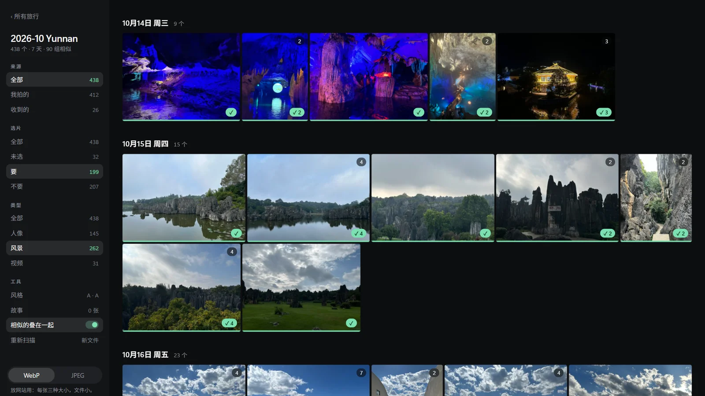

# Media Studio

My photo and video tool for trips. I open a trip's folder of iPhone originals, pick the keepers, give the whole trip one look, and export web-sized photos and short clips for my site. It runs only on my laptop: a small Python server on 127.0.0.1, with its screen in a Chrome app window.



- **Sort**: photos I took, photos I received and screenshots apart; look-alike shots stacked together; portraits and landscapes told apart from the faces the iPhone marks.
- **Pick**: keep or drop each photo, along a timeline by day.
- **One look**: four looks (A–D) for the whole trip, one for landscapes and one for portraits.
- **Export**: WebP photos for the website with a `media.json` list, JPEGs for sharing, and clips of about 7 seconds with their own sound, music or none.

## Safe with my photos

- It never writes, moves or deletes anything in a trip's `originals\` folder, and a test proves a whole run leaves every original unchanged.
- It listens on 127.0.0.1 only, and nothing talks to the internet.
- Exported photos and clips keep the date and time they were taken, and nothing else: no location, no phone name.

## Run it

Set up once:

```powershell
python -m venv .venv
.venv\Scripts\pip install -r requirements.txt
```

Then put `ffmpeg.exe` and `ffprobe.exe` (gyan.dev's 9.0.2 essentials build) into `tools\ffmpeg\`.

| Command | Does |
|---|---|
| `start.cmd` (double-click) | Open Media Studio in a Chrome app window. It stops itself 10 minutes after the window closes. |
| `.venv\Scripts\python.exe -m unittest discover -s tests -t .` | Run the tests |

Trips live in `%USERPROFILE%\Pictures\Trips\<trip>\`, each with an `originals\` folder. The picks and looks are saved in the trip's `studio.json`, and what it makes goes into the trip's `export\`.
